# سند نیازمندی‌های نرم‌افزاری (SRS) و فرآیند توسعه نرم‌افزار (SDP)
## سیستم نوروپلتفرم هوشمند برای کنترل و درمان MS

---

### **سند نیازمندی‌های نرم‌افزاری (SRS)**

#### **1. مقدمه**
##### 1.1 هدف
این سند نیازمندی‌های نرم‌افزاری (SRS) برای سیستم نوروپلتفرم هوشمند کنترل و درمان بیماری MS (مولتیپل اسکلروزیس) تعریف می‌کند. هدف اصلی ایجاد یک سیستم یکپارچه مبتنی بر میکروکنترلر برای نظارت، پیش‌بینی، و درمان تطبیقی بیماری MS است.

##### 1.2 محدوده
این سیستم شامل سه جزء اصلی است:
- ایمپلنت داخل‌جمجمه‌ای برای نظارت و تحریک عصبی
- پچ پوستی برای دارورسانی هدفمند
- سیستم پوشیدنی و موبایل برای مانیتورینگ ۲۴/۷

##### 1.3 مخاطبان
- توسعه‌دهندگان نرم‌افزار و سخت‌افزار
- متخصصان مغز و اعصاب
- تیم تضمین کیفیت
- مدیران پروژه
- مراجع نظارتی پزشکی

#### **2. توصیف کلی**
##### 2.1 چشم‌انداز محصول
ایجاد یک سیستم بسته‌درمانی (closed-loop therapy) که قادر به:
- نظارت پیوسته بر نشانگرهای بیماری MS
- پیش‌بینی حملات از طریق الگوریتم‌های ML
- تحریک عصبی تطبیقی
- دارورسانی هدفمند و شخصی‌سازی شده

##### 2.2 قابلیت‌های سیستم
1. **نظارت بلادرنگ**:
   - ثبت سیگنال‌های عصبی (EEG/ECoG)
   - اندازه‌گیری بیومارکرهای التهابی
   - مانیتورینگ پارامترهای فیزیولوژیک

2. **پیش‌بینی هوشمند**:
   - تشخیص الگوهای پیش‌حمله
   - ارزیابی خطر عود بیماری
   - پیش‌بینی پیشرفت بیماری

3. **درمان تطبیقی**:
   - تحریک عمقی مغز (aDBS)
   - رهایش داروی خودکار
   - تنظیم پارامترهای درمانی

4. **مدیریت بیمار**:
   - رابط کاربری برای بیمار و پزشک
   - گزارش‌گیری و تحلیل داده
   - هشدار و اطلاع‌رسانی

##### 2.3 محدودیت‌ها
- تاخیر پردازش حداکثر ۱۰۰ms برای پاسخ‌های درمانی
- مصرف انرژی محدود برای ایمپلنت‌ها
- محدودیت‌های حافظه در میکروکنترلرها
- الزامات زیست‌سازگاری و ایمنی

#### **3. نیازمندی‌های خاص**
##### 3.1 نیازمندی‌های کاربری

| شناسه | نیازمندی | اولویت | توضیحات |
|-------|----------|---------|----------|
| UR-001 | سیستم باید قادر به ثبت پیوسته ۳۲ کاناله EEG باشد | بالا | نمونه‌برداری ۲۵۶ هرتز |
| UR-002 | پیش‌بینی حملات با دقت حداقل ۸۵٪ | بالا | حداکثر هشدار کاذب ۱۵٪ |
| UR-003 | تنظیم خودکار پارامترهای تحریک | بالا | پاسخ در کمتر از ۵۰ms |
| UR-004 | رابط کاربری موبایل برای بیمار | متوسط | پشتیبانی از iOS و Android |
| UR-005 | پورتال وب برای پزشکان | متوسط | دسترسی امن، گزارش‌گیری |

##### 3.2 نیازمندی‌های عملکردی

| شناسه | ماژول | نیازمندی | معیار سنجش |
|-------|--------|----------|-------------|
| FR-001 | مانیتورینگ | نمونه‌برداری از ۱۰ بیومارکر | هر ۵ دقیقه |
| FR-002 | پردازش سیگنال | فیلتر کردن نویز ۵۰/۶۰Hz | کاهش ۴۰dB |
| FR-003 | پیش‌بینی | اجرای مدل TinyML | حداکثر ۵۰ms |
| FR-004 | تحریک | تنظیم پارامترهای aDBS | ۱۶ بیت دقت |
| FR-005 | دارورسانی | کنترل میکروپمپ | دقت ۰٫۱μL |

##### 3.3 نیازمندی‌های غیرعملکردی

| دسته | نیازمندی | معیار |
|------|----------|-------|
| کارایی | زمان پاسخ سیستم | < ۱۰۰ms |
| قابلیت اطمینان | uptime سیستم | ۹۹٫۹٪ |
| امنیت | رمزنگاری داده‌ها | AES-256 |
| ایمنی | Fail-safe mechanisms | ISO 14971 |
| مصرف انرژی | عمر باتری ایمپلنت | حداقل ۵ سال |

#### **4. نیازمندی‌های طراحی**
##### 4.1 معماری سیستم
```
معماری سه لایه:
1. لایه سخت‌افزاری (ایمپلنت/پوشیدنی)
   - میکروکنترلر nRF52840 + Cortex-M4
   - سنسورهای بیومارکر
   - عملگرهای تحریک و دارورسانی

2. لایه میانی (گیت‌وی/موبایل)
   - جمع‌آوری و پیش‌پردازش داده
   - ارتباط امن با سرور
   - رابط کاربری اولیه

3. لایه ابری/سرور
   - ذخیره‌سازی داده‌های بلندمدت
   - تحلیل‌های پیشرفته ML
   - مدیریت کاربران و دسترسی‌ها
```

##### 4.2 نیازمندی‌های رابط‌ها
- **رابط بیمار-سیستم**: بلوتوث کم‌مصرف (BLE 5.2)
- **رابط پزشک-سیستم**: HTTPS/REST API
- **رابط ایمپلنت‌ها**: ارتباط داخل‌بدنی (حفاظت شده)
- **رابط سنسورها**: I2C/SPI با نرخ نمونه‌برداری مشخص

#### **5. نیازمندی‌های امنیتی و حریم خصوصی**
- رمزنگاری سرتاسری داده‌های پزشکی
- احراز هویت دو عاملی برای دسترسی پزشکان
- ذخیره‌سازی ناشناس داده‌ها برای پژوهش
- رعایت GDPR و HIPAA

---

### **فرآیند توسعه نرم‌افزار (SDP)**

#### **1. مدل فرآیند**
**مدل ترکیبی: Agile + V-Model**
- فازهای اولیه (نیازمندی‌ها، طراحی): V-Model برای تضمین ایمنی
- فازهای پیاده‌سازی: Agile/Scrum برای توسعه تکراری

#### **2. فازهای توسعه**

##### **فاز ۱: تحلیل و برنامه‌ریزی (۲ ماه)**
###### فعالیت‌ها:
1. جمع‌آوری نیازمندی‌های بالینی
2. مطالعه قوانین و مقررات (FDA، CE)
3. تعریف محدوده و ریسک‌ها
4. برنامه‌ریزی منابع و زمان‌بندی

###### خروجی‌ها:
- سند نیازمندی‌های بالینی
- برنامه مدیریت ریسک
- نقشه راه محصول

##### **فاز ۲: طراحی سیستم (۳ ماه)**
###### فعالیت‌ها:
1. طراحی معماری کلی
2. طراحی سخت‌افزار ایمپلنت
3. طراحی پایگاه داده و رابط‌ها
4. طراحی الگوریتم‌های پردازش سیگنال

###### خروجی‌ها:
- نقشه‌های معماری
- طرح‌های سخت‌افزاری
- طرح‌های پایگاه داده
- پروتکل‌های ارتباطی

##### **فاز ۳: پیاده‌سازی (۶ ماه)**
###### ساختار تیم Scrum:
- Product Owner: متخصص مغز و اعصاب
- Scrum Master: مدیر پروژه
- Development Team: ۸-۱۰ نفر

###### اسپرینت‌های ۲ هفته‌ای:
**اسپرینت ۱-۲:** زیرسیستم مانیتورینگ
- پیاده‌سازی خواندن سنسورها
- توسعه درایورهای سخت‌افزاری

**اسپرینت ۳-۴:** پردازش سیگنال
- الگوریتم‌های فیلترینگ
- استخراج ویژگی‌ها

**اسپرینت ۵-۶:** مدل‌های ML
- آموزش مدل‌های TinyML
- بهینه‌سازی برای میکروکنترلر

**اسپرینت ۷-۸:** سیستم تحریک
- کنترلر PID برای aDBS
- ایمنی و محدودیت‌ها

**اسپرینت ۹-۱۰:** رابط کاربری
- اپ موبایل بیمار
- پورتال وب پزشک

**اسپرینت ۱۱-۱۲:** یکپارچه‌سازی و تست

##### **فاز ۴: آزمون و اعتبارسنجی (۴ ماه)**
###### سطح‌های آزمون:
1. **Unit Testing**: هر ماژول جداگانه
2. **Integration Testing**: ارتباط ماژول‌ها
3. **System Testing**: کل سیستم
4. **Clinical Validation**: آزمایشات بالینی محدود

###### ماتریس آزمون:
| نوع آزمون | ابزارها | معیار موفقیت |
|-----------|---------|--------------|
| آزمون عملکرد | Oscilloscope, Logic Analyzer | مطابقت با مشخصات |
| آزمون امنیت | Burp Suite, Custom scripts | عدم نفوذپذیری |
| آزمون کارایی | Profiling tools | زمان پاسخ < ۱۰۰ms |
| آزمون مصرف انرژی | Power Analyzer | عمر باتری مطابق |

##### **فاز ۵: استقرار و نگهداری (مستمر)**
###### برنامه استقرار:
1. آزمایشات حیوانی (مدل EAE)
2. آزمایشات بالینی فاز ۱ (۱۰ بیمار)
3. آزمایشات بالینی فاز ۲ (۵۰ بیمار)
4. دریافت تأییدیه‌های نظارتی
5. عرضه محدود به بازار

###### برنامه نگهداری:
- به‌روزرسانی‌های امنیتی ماهانه
- به‌روزرسانی مدل‌های ML سه‌ماهه
- پشتیبانی فنی ۲۴/۷ برای بیماران
- جمع‌آوری داده برای بهبود الگوریتم‌ها

#### **3. مدیریت کیفیت**

##### استانداردهای اعمال شده:
- ISO 13485 (دستگاه‌های پزشکی)
- IEC 62304 (نرم‌افزار پزشکی)
- IEC 60601-1 (ایمنی الکتریکی)

##### فعالیت‌های تضمین کیفیت:
- بازرسی‌های کد هفتگی
- تحلیل ایستایی کد (SonarQube)
- تست پوشش کد (هدف: ۹۰٪)
- بررسی امنیت کد

#### **4. مدیریت پیکربندی**

##### ابزارها:
- کنترل نسخه: Git (GitLab)
- پیگیری issues: JIRA
- CI/CD: GitLab CI
- مستندات: Confluence

##### برچسب‌های نسخه‌گذاری:
```
v<major>.<minor>.<patch>.<build>
مثال: v1.2.3.456
- major: تغییرات ناسازگار
- minor: قابلیت‌های جدید
- patch: رفع خطاها
- build: شماره ساخت
```

#### **5. مدیریت ریسک**

##### ریسک‌های اصلی:
1. **ریسک فنی**: دقت ناکافی پیش‌بینی
   - راهکار: استفاده از چند مدل، افزایش داده‌های آموزشی

2. **ریسک ایمنی**: عوارض جانبی تحریک
   - راهکار: محدودیت‌های سخت‌افزاری، نظارت مداوم

3. **ریسک نظارتی**: عدم دریافت تأییدیه
   - راهکار: مشارکت زودهنگام با ناظران

4. **ریسک امنیتی**: نشت داده‌های بیماران
   - راهکار: رمزنگاری سرتاسری، ممیزی امنیتی

#### **6. مستندات مورد نیاز**

##### فهرست مستندات:
1. SRS (این سند)
2. طراحی سیستم
3. طراحی تفصیلی
4. برنامه آزمون
5. راهنمای کاربر
6. راهنمای نصب
7. گزارش‌های آزمون
8. مستندات نگهداری

#### **7. معیارهای موفقیت**

##### معیارهای فنی:
- دقت پیش‌بینی حملات: ≥ ۸۵٪
- حساسیت تشخیص: ≥ ۹۰٪
- ویژگی تشخیص: ≥ ۸۰٪
- زمان پاسخ سیستم: ≤ ۱۰۰ms

##### معیارهای بالینی:
- کاهش ۵۰٪ در دفعات حمله
- بهبود ۳۰٪ در کیفیت زندگی بیماران
- کاهش ۴۰٪ در مصرف داروهای سیستمیک

##### معیارهای تجاری:
- دریافت تأییدیه FDA/CE در ۳ سال
- کاهش ۲۰٪ هزینه‌های درمان در ۵ سال
- رضایت ۹۰٪ کاربران

---

### **پیوست‌ها**

#### **پیوست A: واژه‌نامه**
- **MS**: Multiple Sclerosis (مولتیپل اسکلروزیس)
- **aDBS**: adaptive Deep Brain Stimulation
- **EEG**: Electroencephalography
- **ECoG**: Electrocorticography
- **TinyML**: Machine Learning for microcontrollers

#### **پیوست B: مراجع**
1. ISO 13485:2016 - Medical devices
2. IEC 62304:2006 - Medical device software
3. FDA Guidance - Implantable Neurostimulators
4. EMA Guidelines - Advanced Therapy Medicinal Products

# سند نیازمندی‌های نرم‌افزاری (SRS) و فرآیند توسعه نرم‌افزار (SDP)
## سیستم نوروپلتفرم هوشمند برای کنترل و درمان MS

---

## **فهرست نمودارهای Mermaid**

1. [نمودار معماری کلی سیستم](#نمودار-معماری-کلی-سیستم)
2. [نمودار فازهای توسعه](#نمودار-فازهای-توسعه)
3. [نمودار فرآیند Scrum](#نمودار-فرآیند-scrum)
4. [نمودار فرآیند آزمون](#نمودار-فرآیند-آزمون)
5. [نمودار مدیریت ریسک](#نمودار-مدیریت-ریسک)
6. [نمودار پیکربندی سیستم](#نمودار-پیکربندی-سیستم)

---

### **سند نیازمندی‌های نرم‌افزاری (SRS)**

#### **1. مقدمه**

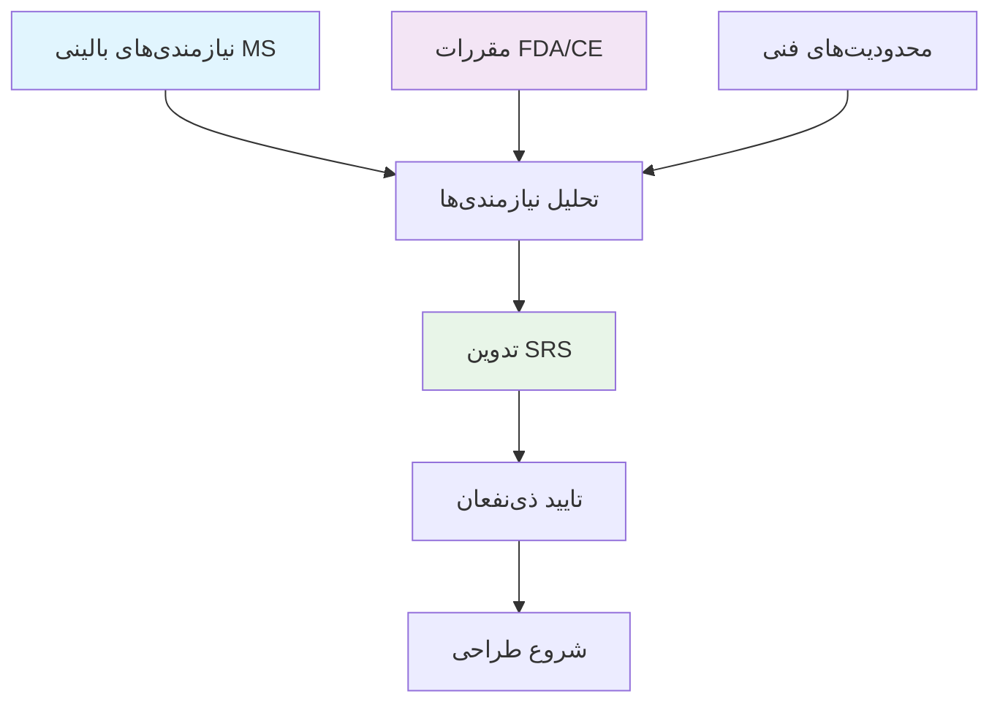

##### 1.1 هدف
این سند نیازمندی‌های نرم‌افزاری (SRS) برای سیستم نوروپلتفرم هوشمند کنترل و درمان بیماری MS تعریف می‌کند.

##### 1.2 محدوده سیستم
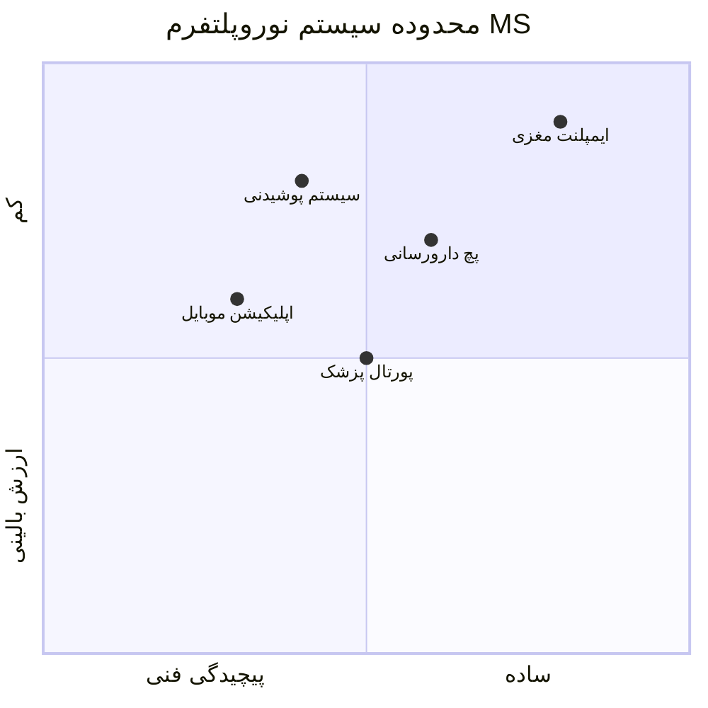

##### 1.3 ذی‌نفعان اصلی
- بیماران مبتلا به MS
- متخصصان مغز و اعصاب
- توسعه‌دهندگان سیستم
- مراجع نظارتی (FDA، CE)
- بیمه‌گذاران سلامت

#### **2. توصیف کلی سیستم**

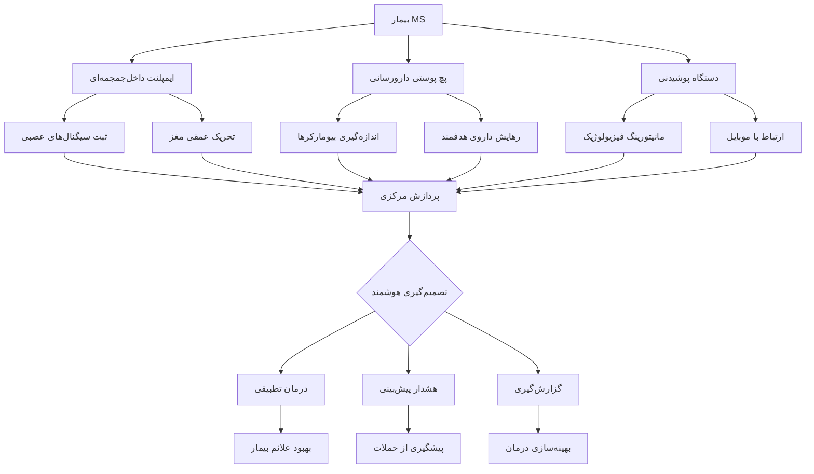

#### **3. نیازمندی‌های خاص**

##### 3.1 نیازمندی‌های کاربری

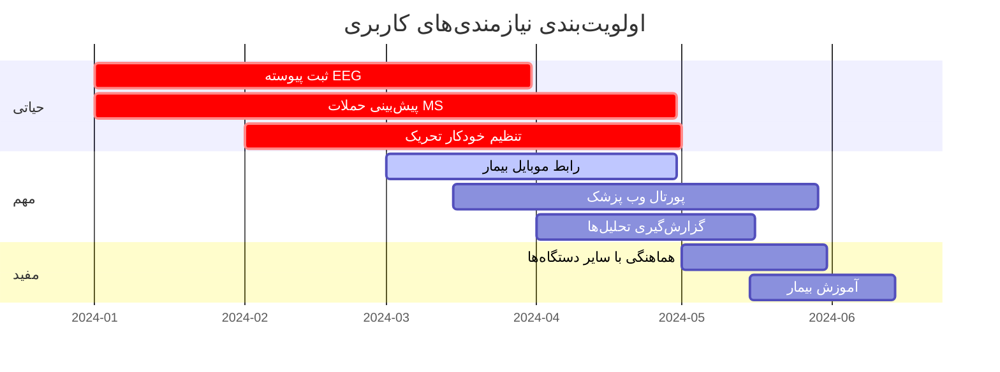

##### 3.2 نیازمندی‌های عملکردی

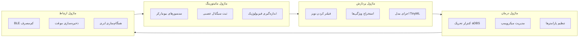

##### 3.3 نیازمندی‌های غیرعملکردی

```mermaid
radar-chart
    title ماتریس نیازمندی‌های غیرعملکردی
    axis کارایی, قابلیت‌اطمینان, امنیت, ایمنی, مصرف‌انرژی, مقیاس‌پذیری
    "حداقل قابل قبول" : [70, 80, 90, 95, 80, 60]
    "هدف طراحی" : [90, 95, 99, 99, 90, 80]
    "ایده‌آل" : [100, 99, 100, 100, 95, 95]
    
    scale 5
```

#### **4. معماری سیستم**

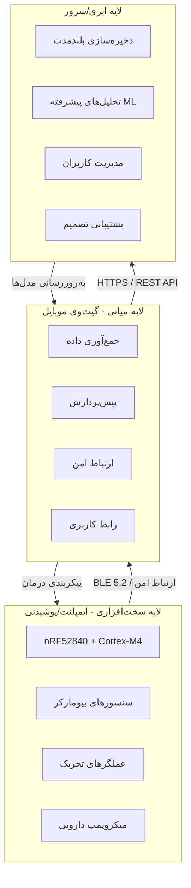

---

### **فرآیند توسعه نرم‌افزار (SDP)**

#### **1. مدل فرآیند توسعه**

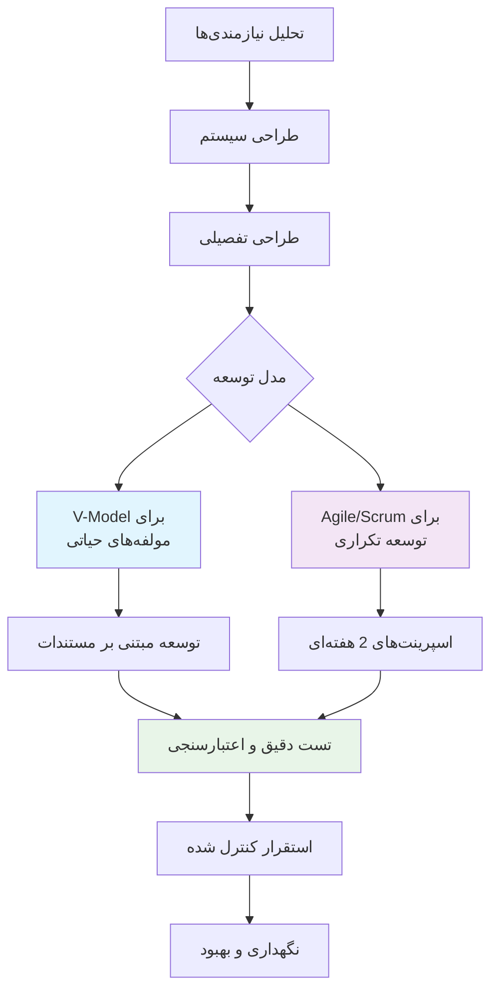

#### **2. فازهای توسعه - جریان کلی**

```mermaid
timeline
    title مسیر توسعه 18 ماهه
    section فاز 1: تحلیل و برنامه‌ریزی
        ماه 1-2 : جمع‌آوری نیازمندی‌های بالینی
                 : مطالعه قوانین و مقررات
        ماه 2 : تعریف محدوده و ریسک‌ها
              : برنامه‌ریزی منابع
    
    section فاز 2: طراحی سیستم
        ماه 3-5 : طراحی معماری کلی
                : طراحی سخت‌افزار ایمپلنت
                : طراحی پایگاه داده
    
    section فاز 3: پیاده‌سازی
        ماه 6-11 : اسپرینت‌های توسعه
                 : یکپارچه‌سازی ماژول‌ها
                 : تست‌های اولیه
    
    section فاز 4: آزمون و اعتبارسنجی
        ماه 12-15 : تست واحد و یکپارچه‌سازی
                  : تست سیستم
                  : اعتبارسنجی بالینی
    
    section فاز 5: استقرار
        ماه 16-18 : آزمایشات حیوانی
                  : مطالعات بالینی محدود
                  : آماده‌سازی بازار
```

#### **3. فرآیند توسعه Agile/Scrum**

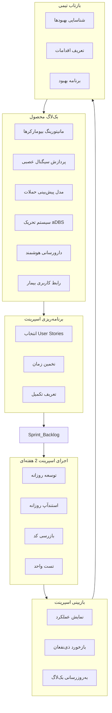

#### **4. فرآیند آزمون و اعتبارسنجی**

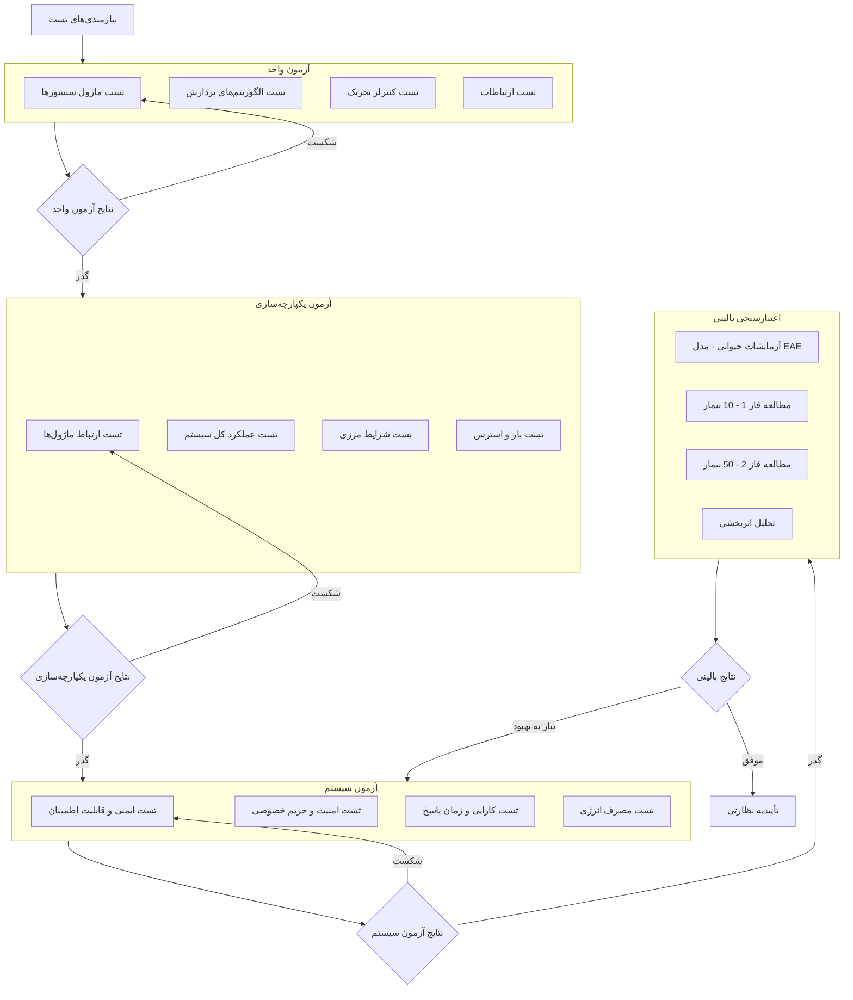

#### **5. مدیریت ریسک پروژه**

```mermaid
quadrantChart
    title ماتریس مدیریت ریسک
    x-axis "احتمال وقوع" --> "کم"
    y-axis "شدت تاثیر" --> "جزئی"
    
    "دقت ناکافی پیش‌بینی": [0.7, 0.8]
    "عوارض جانبی تحریک": [0.4, 0.9]
    "عدم دریافت تأییدیه FDA": [0.5, 0.9]
    "نشت داده‌های بیماران": [0.3, 0.95]
    "مصرف انرژی بالا": [0.6, 0.6]
    "زمان توسعه طولانی": [0.8, 0.5]
    "محدودیت‌های حافظه": [0.7, 0.4]
    "مقاومت بیماران": [0.5, 0.3]
    
    scale 10
```

#### **6. مدیریت پیکربندی و CI/CD**

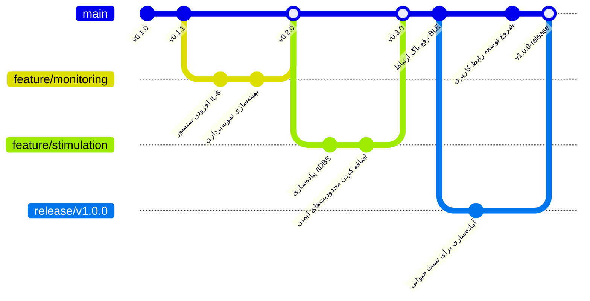

#### **7. فرآیند استقرار و نگهداری**

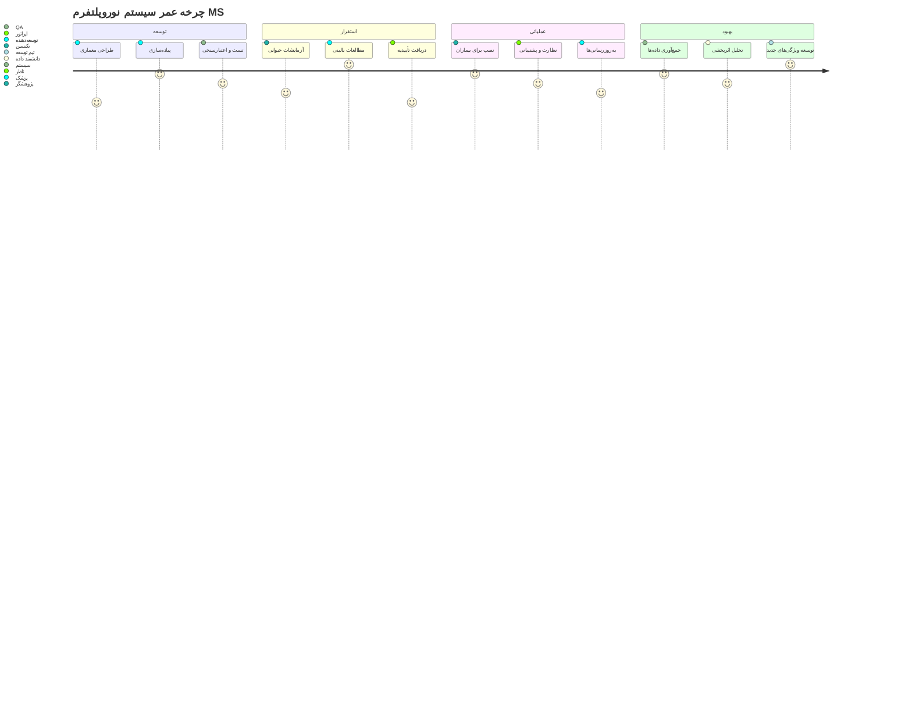

#### **8. معیارهای موفقیت و KPIها**

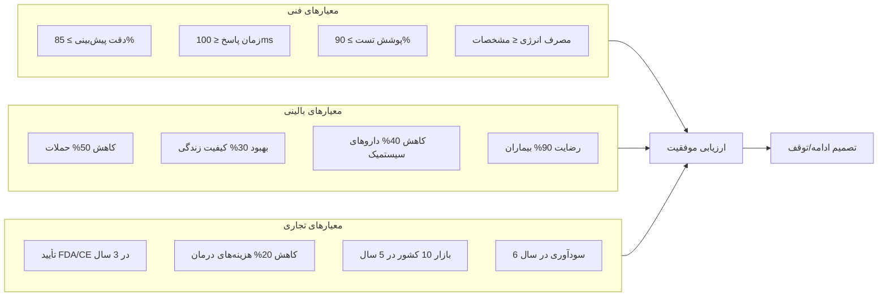

---

### **پیوست‌ها**

#### **پیوست A: ساختار تیم توسعه**

```mermaid
orgChart
    title ساختار تیم توسعه پروژه
    direction LR
    
    "مدیر پروژه" as PM
    "متخصص مغز و اعصاب<br>(Product Owner)" as PO
    
    PM --> "تیم توسعه سخت‌افزار"
    PM --> "تیم توسعه نرم‌افزار"
    PM --> "تیم QA و تست"
    PM --> "تیم پشتیبانی فنی"
    
    PO --> "تیم توسعه نرم‌افزار"
    
    "تیم توسعه سخت‌افزار" : "مهندس الکترونیک", "مهندس زیستی", "متخصص مواد"
    "تیم توسعه نرم‌افزار" : "توسعه‌دهنده Embedded", "توسعه‌دهنده موبایل", "متخصص ML", "توسعه‌دهنده بک‌اند"
    "تیم QA و تست" : "تست‌کننده سخت‌افزار", "تست‌کننده نرم‌افزار", "متخصص اعتبارسنجی بالینی"
    "تیم پشتیبانی فنی" : "پشتیبان فنی", "مدیر سیستم", "متخصص امنیت"
```

#### **پیوست B: برنامه زمانی منابع**

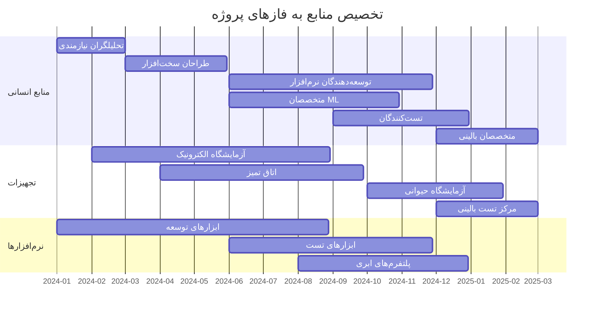

#### **پیوست C: ماتریس ردیابی نیازمندی‌ها**

```mermaid
xychart-beta
    title ردیابی پوشش نیازمندی‌ها در طول زمان
    x-axis [اسپرینت 1, اسپرینت 2, اسپرینت 3, اسپرینت 4, اسپرینت 5, اسپرینت 6]
    y-axis "درصد پوشش" 0 --> 100
    bar [20, 40, 60, 75, 85, 95]
    line [25, 50, 70, 80, 90, 100]
```

---

**
